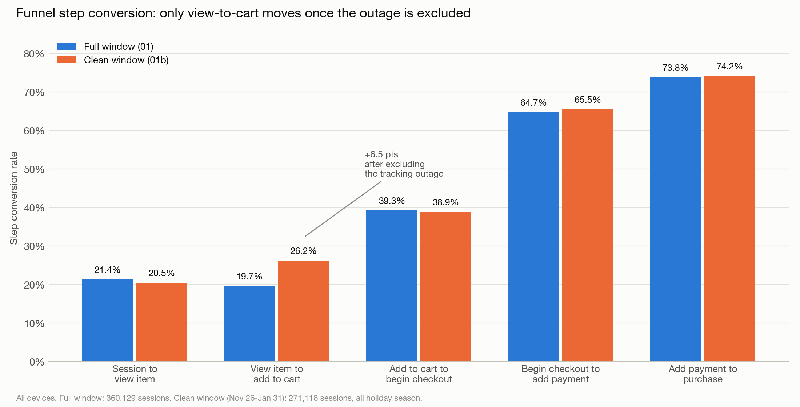
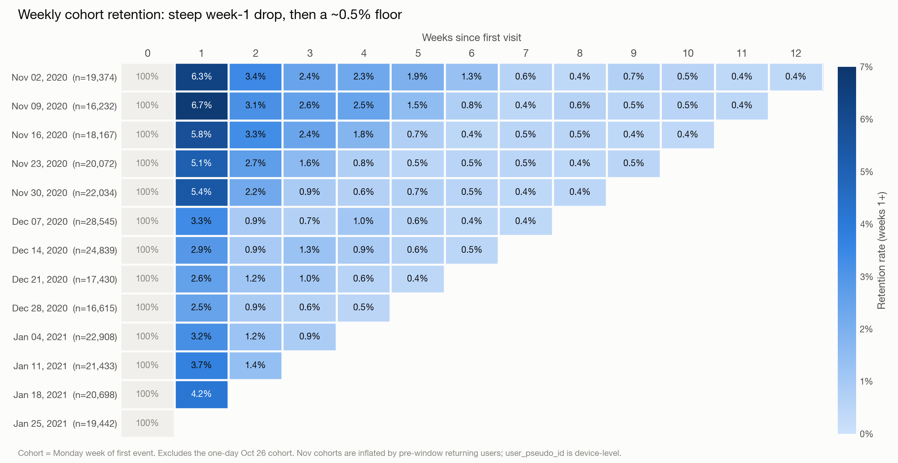

# GA4 E-commerce Funnel, Retention & North Star Analysis

SQL analysis of Google Analytics 4 event data from the Google Merchandise Store, run in BigQuery.
The project builds a session-level purchase funnel, checks it for tracking problems, re-runs it on a
clean window, measures weekly cohort retention, and tracks a North Star metric (weekly purchasing users)
with average order value (AOV) as a guardrail. The main result: once a tracking outage is excluded, the
largest leak in a reliably tracked stage is add to cart → begin checkout (61% drop). Device type makes no
meaningful difference. Holiday-season growth came from more buyers rather than larger orders.

## Question

Where does the store lose buyers between first visit and purchase, do new visitors come back, and what
drove purchasing over the 2020 holiday season?

## Data

- **Source:** `bigquery-public-data.ga4_obfuscated_sample_ecommerce.events_*` (public BigQuery dataset)
- **Window:** 2020-11-01 to 2021-01-31

### Limitations

- **Obfuscated sample.** Google obfuscates this dataset, so treat absolute numbers as illustrative.
  Some fields hold placeholder values such as `<Other>` or `(data deleted)`.
- **Holiday season only.** All three months fall in peak retail season, so seasonality cannot be
  separated from other effects (for example, the clean-window conversion lift mixes tracking repair and seasonality).
- **add_to_cart tracking gap.** add_to_cart was effectively untracked Nov 1-25 (92% of purchase sessions
  lack it). After Nov 26, 24% of purchase sessions still lack it, for reasons not yet known. Funnel
  conclusions about view → cart use Nov 26-Jan 31 only.
- **transaction_id tracking gap.** transaction_id is missing Nov 1-8, 42% missing in the week of Nov 9, and
  70% missing in the week of Jan 25. Duplicate purchase events inflated revenue in mid-November.
  AOV is reported for weeks Nov 16-Jan 18 only.
- **Device-level users.** `user_pseudo_id` identifies a device, not a person, so retention is understated.
- **Left-censoring.** Data starts Nov 1, so early-November cohorts include users who first
  visited before the window. The Oct 26 cohort (Nov 1 only) is excluded.

## Files

| Query (`sql/`) | Result (`results/`) | What it answers |
|---|---|---|
| `01_funnel_by_device.sql` | `01_funnel_by_device.csv` | Session funnel by device, full window (kept for comparison; use 01b for conclusions) |
| `01b_funnel_clean_window.sql` | `01b_funnel_clean_window.csv` | Same funnel, Nov 26-Jan 31 (after the add_to_cart outage) |
| `02_dq_check.sql` | `02_dq_check.csv` | Purchase sessions missing an earlier funnel step |
| `03_dq_missing_cart_by_date.sql` | `03_dq_missing_cart_by_date.csv` | Missing add_to_cart by date (outage vs steady gap) |
| `04_cohort_retention.sql` | `04_cohort_retention.csv` | Weekly cohort retention |
| `05_north_star_weekly.sql` | `05_north_star_weekly.csv` | Weekly purchasing users, revenue, AOV (before dedup) |
| `05b_aov_dedup.sql` | `05b_aov_dedup.csv` | AOV with purchases deduplicated by transaction_id |

Other folders:
- `notebooks/`: chart notebooks (`04_cohort_heatmap.ipynb`, `01b_funnel_comparison.ipynb`)
- `memo/findings.md`: running analysis notes, one section per query
- `app/`: interactive dashboard (planned)

## Charts

**Funnel step conversion, full window vs clean window**

**Weekly cohort retention**

## Key findings

1. **A tracking outage overstated the view → cart drop.** In the full window, 2,000 of 4,848
   purchase sessions (41.3%) had no add_to_cart event. Excluding the Nov 1-25 outage raises
   view → cart from 19.7% to 26.2% (14,567 / 55,502); the drop is still the largest in the funnel
   (74%), but smaller than it first appeared. The other steps barely move.
2. **Cart → checkout is the biggest leak in a reliably tracked stage.** In the clean window, 38.9% of carts
   reach checkout (61% drop), while checkout → payment is 65.5% and payment → purchase is 74.2%.
3. **No meaningful device gap.** Mobile 1.05% vs desktop 0.99% session conversion (z = 1.68, p ≈ 0.09)
   in the clean window. Step rates are within 1-2 points across devices.
4. **Retention drops steeply after week 1, then levels off.** Across 270,154 users in 14 cohorts, week-1
   retention is 4.2% and week-2 is 1.9%. Most cohorts settle at ~0.4-0.6% by weeks 5-6. December
   cohorts look more one-and-done: week-1 retention is 2.9% for Dec cohorts vs 5.8% for Nov cohorts.
   Part of this gap comes from left-censoring (Nov cohorts include returning users from before the
   window) and from Dec 21/28 cohorts' week 1 falling on Christmas and New Year.
5. **The North Star peaked in the second week of December, not on Black Friday.** Weekly purchasing users
   went 242 (wk Nov 2) → 497 (Black Friday wk) → 573 (Cyber Monday wk) → peak 737 (wk Dec 7) → 136 (wk Dec 28).
6. **Growth came from more buyers, not bigger orders.** Weekly purchasing users doubled
   (364 → 737) from mid-November to the December peak, while deduplicated AOV held at ~$71.
   Overall AOV was $69.68 across 4,138 orders (wks Nov 16-Jan 18). The apparent November AOV of
   ~$100 came from duplicate purchase events and from counting revenue without a transaction_id.
   Flat AOV does not rule out discounting.

## Next steps

- Activation: which first-week behaviors are associated with return visits (associational, not causal)
- Feature adoption: search and promotion usage
- Check whether the remaining 24% of purchases without add_to_cart added to cart in an earlier session
- Size 3-5 improvement opportunities and rank them with RICE
